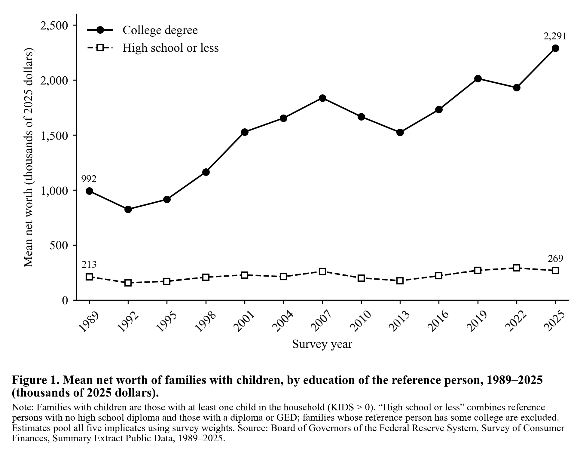

# Wealth gap by parental education, 1989–2025

This repository reproduces the Section 3 lab figure (Option B) for PS 158. The figure plots mean net worth of US families with children, comparing families whose reference person has a college degree with families whose reference person has a high school education or less. It runs from 1989 to the 2025 survey.



## Data

The data come from the Federal Reserve Board's [Survey of Consumer Finances](https://www.federalreserve.gov/econres/scfindex.htm), using the Summary Extract Public Data files (`scfpYYYYexcel.zip`) for each survey from 1989 to 2025. With the 2025 release (October 9, 2026), the Fed re-issued every year's extract with dollar values adjusted to 2025 dollars, so years can be compared directly.

Variables used: `NETWORTH`, `EDCL` (education of the reference person), `KIDS` (number of children in the household) and `WGT` (survey weight).

## Choices

- **Families with children only:** `KIDS > 0`.
- **Education is that of the SCF reference person**, not both parents.
- **"High school or less"** combines `EDCL` 1 (no diploma) and 2 (diploma or GED). **"College degree"** is `EDCL` 4. "Some college" (`EDCL` 3) is left out.
- **Mean net worth.** Medians are also saved in `data/networth_by_educ.csv`.
- Each family appears as five implicates (five versions of its record, each filling in missing answers differently). All rows are pooled using `WGT`.

## Checks

- **Fed Table 4:** the Fed publishes no table of families with children by education. Instead, I checked the method on all families. For 1989 and 2025, the same weighting reproduces the Fed's published Table 4 (`scf2025_tables_public_real_historical.xlsx`) means and medians by education exactly. For example, the 2025 college-degree median is $505.03k and the mean is $2,240.46k.
- **Lab dry run:** the dry run found that among families with children, the 2025 gap is about as wide as in 2013. Our college ÷ high-school-or-less ratio of means is 8.6× in 2013 and 8.5× in 2025.
- **Lab dry-run figure:** compared by eye with the dry-run figure on the lab page. The lines have the same shape and the 2025 points match (about $2.29M for college degree and $270k for high school or less).

## Things to keep in mind

- **The 1989 file uses a different household ID column.** It is `XX1` instead of `YY1`, and `get_data.py` handles both.
- **The groups changed size.** "High school or less" fell from 56% to 36% of families with children between 1989 and 2025, while "college degree" rose from 23% to 40%.
- **Samples are modest.** Each group-year has roughly 540–1,160 families, and the CSV records this as `n_families`. Small year-to-year changes may be noise.

## Rerunning

```bash
python3 -m venv .venv
.venv/bin/pip install -r requirements.txt
.venv/bin/python get_data.py   # downloads extracts to data/raw/, writes data/networth_by_educ.csv
.venv/bin/python plot.py       # writes figures/mean_networth_by_educ.png and .pdf
```
